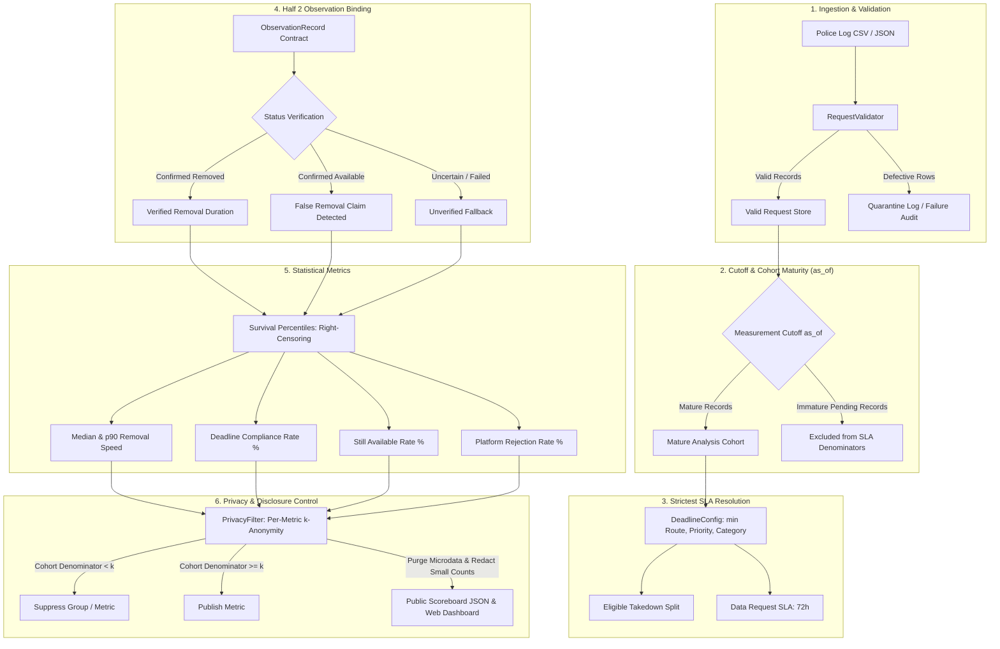

# Methodology & Metric Specifications

This document outlines the scientific definitions, mathematical formulas, data filtering logic, privacy controls, and audit limitations governing **Half 1: Requests and Speed** and the shared observation integration with **Half 2: Verification and Integrity** within the Social Media Takedown Accountability Platform.

> **Demonstration Notice**:
> In demonstration mode, this platform uses 100% synthetic records with **fictional platform identities** (`Platform A` through `Platform J`) and simulated profiles. Figures generated from synthetic data do not represent genuine intermediary compliance, actual platform responsiveness, or real police investigations. Real platform names (`Meta`, `YouTube`, etc.) are reserved strictly for authorized, isolated law enforcement deployment.

---

## 1. System Dataflow & Processing Architecture



---

## 2. Statutory Deadlines & Strictest Resolution (2026 IT Rules)

### 2.1. Statutory Timelines
Amended timelines under the Information Technology (Intermediary Guidelines and Digital Media Ethics Code) Rules, 2021 (amended effective 20 February 2026; Gazette notification 269993):

1. **Rule 3(1)(d) (Specified Court Orders or Authorized Government Intimations)**:
   - **Deadline**: **3.0 hours** from formal communication.
   - **Applicable Route**: `court_order_or_govt_intimation`.
2. **Rule 3(2)(b) (Grievance Complaints on Specified Harm Categories)**:
   - **Deadline**: **2.0 hours** from receipt of complaint.
   - **Qualifying Categories**: Child Sexual Abuse Material (`CSAM`), Non-Consensual Intimate Imagery and morphed content (`NonConsensualImagery`), and `Impersonation`.
   - **Critical Rule**: The 2-hour deadline does **not** automatically apply to every request labeled NCII; the legal route must be `grievance_complaint_3_2_b`.
3. **Operational Priorities**:
   - `emergency_life_threat`: **2.0 hours** (imminent danger to human life).
   - `urgent`: **3.0 hours** (priority operational escalation).
   - `routine`: **36.0 hours** (standard operational default).
4. **Data Assistance Requests**:
   - **Deadline**: **72.0 hours** under statutory data-assistance provisions. Content-removal SLAs are **never** applied to data requests.

### 2.2. Conflict Resolution Order
When multiple deadlines are applicable (e.g., category default, legal route, and operational priority), the engine selects the **strictest applicable deadline**:

$$\text{Effective Deadline} = \min(\text{Applicable Candidates})$$

*Example*: If Harm Category = `FinancialFraud` (36h default), Operational Priority = `urgent` (3h), and Legal Route = `court_order_or_govt_intimation` (3h):
$$\text{Selected Deadline} = \min(36.0, 3.0, 3.0) = 3.0\text{ hours}$$

An urgent priority is never silently ignored or relaxed by a category default.

### 2.3. Statutory Police Intimations vs. Operational Assumptions
1. **Rule 3(1)(d) Police Intimations (3.0 Hours)**:
   Formal police takedown notices issued under Section 79(3)(b) by an authorized law enforcement officer or agency constitute authorized government intimations under Rule 3(1)(d). Under the 2026 amendments (Gazette No. 269993), these carry a mandatory **3.0-hour** compliance deadline.
2. **Operational Fallback Assumptions**:
   Non-statutory communications or informal inquiries (`routine_police_inquiry`) fall back to operational defaults (36.0 hours).
3. **Ambiguous or Missing Route Information**:
   If `legal_route` is absent or `other`, the engine relies strictly on applicable category and priority rules. It does not fabricate a statutory 2h or 3h compliance route without supporting evidence. Law enforcement logs must record `court_order_or_govt_intimation` or `grievance_complaint_3_2_b` to trigger statutory SLA tracking.

---

## 3. Measurement Cutoff (`as_of`) and Cohort Maturity

To prevent temporal bias where pending requests submitted shortly before report generation are unfairly penalized:

1. **Explicit Reporting Cutoff (`as_of`)**:
   Every calculation accepts an ISO 8601 UTC timestamp `as_of`. If not provided, it defaults to a single UTC timestamp captured at report generation start.
2. **Takedown Cohort Maturity Rule**:
   A takedown enters the mature analysis cohort if and only if:
   - It was verified removed before `as_of` ($\text{verified\_removed\_at} \le \text{as\_of}$); OR
   - It was claimed removed before `as_of` ($\text{claimed\_removal\_at} \le \text{as\_of}$) and the verifier has not contradicted the claim (section 6.3); OR
   - It was rejected before `as_of` ($\text{sent\_at} \le \text{as\_of}$); OR
   - Its applicable deadline has elapsed by `as_of` ($\text{sent\_at} + \text{deadline\_hours} \le \text{as\_of}$).
3. **Data Request Cohort Maturity Rule**:
   A data assistance request enters the mature data cohort if and only if:
   - Data was provided before `as_of` ($\text{data\_provided\_at} \le \text{as\_of}$); OR
   - It was rejected before `as_of` ($\text{sent\_at} \le \text{as\_of}$); OR
   - Its statutory 72-hour deadline has elapsed by `as_of` ($\text{sent\_at} + 72.0\text{h} \le \text{as\_of}$).
4. **Immature Pending Exclusions**:
   Requests whose deadlines have not yet elapsed by `as_of` are **immature**. They are strictly excluded from compliance denominators and speed percentiles. A data request sent 30 minutes before export cannot drop compliance from 100% to 95%.

---

## 4. Removal-Time Percentiles & Right-Censoring

### 4.1. The Survivorship Bias Problem
Calculating median and p90 removal times using only requests marked `claimed_removed` creates severe survivorship bias. For example, if Platform A removes 20 requests in 10 hours, while Platform B removes 10 in 1 hour and leaves 10 unresolved indefinitely, an un-censored calculation would report Platform B as 10x faster (1.0h vs 10.0h).

### 4.2. Survival Analysis Formulation
We calculate removal-time percentiles over the entire eligible, mature takedown cohort of size $N$:

$$N = k + U$$
where:
- $k$: count of confirmed removals with finite observed durations $t_0 \le t_1 \le \dots \le t_{k-1}$.
- $U$: count of mature unresolved requests (content still available past deadline), treated as right-censored outcomes with duration $> \text{deadline}$ (conceptually $+\infty$).

For any target percentile $p \in [0, 100]$:
$$\text{Rank} = \frac{p}{100} \times (N - 1)$$
$$i_{\text{low}} = \lfloor \text{Rank} \rfloor, \quad i_{\text{high}} = \lceil \text{Rank} \rceil$$

1. **Finite Rank ($i_{\text{high}} < k$)**:
   Both bounds fall within the finite durations:
   $$\text{Percentile} = t_{i_{\text{low}}} + (\text{Rank} - i_{\text{low}}) \times (t_{i_{\text{high}}} - t_{i_{\text{low}}})$$
   Serialized as finite number `numeric_hours`, `is_censored = false`.
2. **Right-Censored Rank ($i_{\text{high}} \ge k$)**:
   The percentile rank touches or falls into the unremoved, censored outcomes.
   Serialized safely as:
   - `numeric_hours: null` (never `Infinity` or `NaN`)
   - `is_censored: true`
   - `display: "> measurement window"`

In the Platform A vs Platform B example:
- **Platform A**: $N=20, k=20$. Rank for median = 9.5 ($< 20$). Median = **10.0 hours**.
- **Platform B**: $N=20, k=10$. Rank for median = 9.5. Upper index $10 \ge k (10)$. Median is **right-censored** (`> measurement window`), not 1.0 hour.

---

## 5. Separate Platform Rejection Reporting

1. **Rejection Outcome Isolation**:
   Platform refusals (`status == 'rejected'`) are audited in separate metrics (`rejections_count` and `rejection_rate_pct`).
2. **Non-Equivalence Rules**:
   - A rejection is **not** counted as content removal.
   - A rejection is **not** automatically counted as confirmed content availability (unless verified by an independent observation).
   - Rejections do not distort the removal-time speed distribution.
3. **Privacy Protection**:
   Small rejection counts ($< k$) are redacted from public output to prevent disclosure.

---

## 6. Independent Verification & Integrity Metrics (Half 2)

Platforms report their own removal times. The verifier checks independently whether reported content is actually gone, and the integrity metrics measure how far platform claims can be trusted.

### 6.1. How the verifier checks

* **Schedule**: each complete takedown request is checked every 15 minutes, starting 15 minutes after it is sent, until removal is confirmed, monitoring ends (30 days) or the `as_of` cutoff. No check happens after `as_of`.
* **Confirmation**: removal needs two DOWN results in a row (inconclusive checks in between are ignored), so one glitchy 404 is not a removal. `verified_removed_at` is the first DOWN of that run. Removal times therefore have 15-minute resolution.
* **Re-upload scan**: after verified removal, the re-upload detector scans every 6 hours for 7 days.
* **Pluggable**: checks go through the `AvailabilityChecker` and `ReuploadDetector` interfaces (`src/takedown_tracking/verifier/checker.py`). This repository ships only a simulator. A real deployment implements the interfaces inside the police network, where request IDs are resolved to URLs; URLs, content and hashes never leave the checker.
* **No downloading**: checkers report only up / down / unknown. They never download or store content.

### 6.2. Observation contract

The verifier hands over one record per monitored request (`schemas/observation.schema.json`):

| Field | Meaning |
| :--- | :--- |
| `observation_status` | `confirmed_removed`, `confirmed_available` (up at the last conclusive check), `uncertain` (platform reached but content not visible: login wall, private, geo-blocked) or `failed_check` (timeouts, errors) |
| `first_checked_at` | First check |
| `last_seen_up_at` | Last check that found the content up |
| `verified_removed_at` | First check that found it gone (confirmed) |
| `reupload_detected_at` | First matching copy found after removal |
| `last_checked_at` | Most recent check |
| `check_error` | Why checks were inconclusive (fixed codes, no free text) |

Records are validated on load: status and timestamps must be consistent (`first_checked_at <= last_seen_up_at < verified_removed_at <= last_checked_at`), and free-text fields are rejected so URLs cannot leak in.

### 6.3. How verification changes the speed metrics

Rules in `src/takedown_tracking/integrity/rules.py` are shared by the speed metrics and the integrity metrics:

1. **Verified removal wins.** If the verifier confirmed removal, `verified_removed_at` is the removal time, even if the platform claimed an earlier time or never reported the removal.
2. **Contradicted claims don't count.** If the verifier saw the content up after the platform's claim, the content counts as not removed until the verifier confirms removal.
3. **Fallback.** With no conclusive observation (none, `uncertain`, `failed_check`), the platform's claim is used. Inconclusive checks are never treated as removal.

### 6.4. Integrity metrics

All cover complete takedown requests in the published categories (section 8) sent before `as_of`, overall and per platform.

* **Verification coverage (%)** = requests with an observation ÷ eligible requests.
* **Unverifiable (%)** = observations that are `uncertain` or `failed_check` ÷ observations. High values mean the other integrity figures cover less of the platform's activity.
* **False removal claim rate (%)** = false claims ÷ claims checked.
  * *Claims checked*: removal claims made before `as_of`, with a conclusive observation whose last check is at or after the claim.
  * *False claim*: `last_seen_up_at` is more than **15 minutes** (cache and clock allowance) after `claimed_removal_at`. This catches both content that stayed up for hours before being removed and content never removed. Only evidence known by `as_of` is used.
* **Silent removals** = verified removals of requests the platform never reported as removed (`pending`, `acknowledged`, `expired`).
* **Re-upload rate (%)** = removals with a matching copy found within **7 days** ÷ verified removals whose 7-day window has fully passed by `as_of`. Removals with an open window are left out, so recent removals don't make the rate look better than it is.

### 6.5. Publication rule

Each integrity figure is published only when the group it describes has at least $k$ requests (default 10): coverage and claims checked use eligible requests, the false claim count and rate use claims checked, the re-upload count and rate use the re-upload cohort, and so on. A count and its rate are always shown or hidden together, so a hidden count can never be recovered from a published rate.

### 6.6. Limitations

* The simulator's behaviour profiles are invented for fictional platforms. Demo figures say nothing about real platforms.
* Removal times have the resolution of the check interval (15 minutes).
* Content that is removed and later restored at the same address is not modelled; the verifier stops checking after confirmed removal.
* A re-upload is only found if the detector can see it. The re-upload rate is a lower bound.

---

## 7. URL Cryptographic Pseudonymization (HMAC-SHA-256)

1. **Vulnerability of Plain SHA-256**:
   Plain SHA-256 hashes of known candidate URLs are vulnerable to dictionary pre-computation and re-identification attacks.
2. **HMAC-SHA-256 Standard**:
   All URL identifiers use HMAC-SHA-256 keyed with a deployment secret (`TAKEDOWN_HMAC_SECRET`):
   $$\text{content\_url\_hmac} = \text{HMAC-SHA-256}(\text{SecretKey}, \text{CanonicalURL})$$
3. **Fail-Closed Protection**:
   In non-synthetic production execution, if `TAKEDOWN_HMAC_SECRET` is unset, the validator immediately fails closed.
4. **Boundary Distinction**:
   HMAC URL identifiers enable privacy-preserving record correlation across workstreams. PDQ perceptual image matching remains strictly inside Half 2's isolated verifier environment.

---

## 8. Strengthened Privacy Controls ($k$-Anonymity)

1. **Generic Suppression Reasons**:
   Public suppression reasons never include exact cohort sizes. The standardized explanation is:
   `"Suppressed because the group is below the publication threshold."`
2. **Independent Per-Metric Denominators**:
   The $k$-anonymity threshold ($k=10$) is enforced independently for each published metric:
   - Takedown removal speed: requires speed cohort size $\ge k$ ($(\text{completed\_takedowns} + \text{still\_available\_takedowns}) \ge k$, excluding rejections).
   - Takedown compliance & availability rates: requires mature actionable takedowns $\ge k$.
   - Data request turnaround (median/p90): requires completed responses $\ge k$ ($\text{completed\_data\_requests} \ge k$).
   - Data request compliance rate: requires $\text{mature\_data\_requests} \ge k$.
   - Integrity breakdowns: requires $\text{integrity\_cohort} \ge k$.
3. **Small-Count Redaction**:
   Small counts of incomplete police requests ($< k$) and platform rejections ($< k$) are redacted (`null`) to eliminate indirect re-identification through subtraction.
4. **Scope Filtering by Default Reporting Scope**:
   Default public reports are restricted to high-impact victim-protection categories (`CSAM`, `NonConsensualImagery`, `Impersonation`, `FinancialFraud`). The privacy filter scopes input records to `published_categories` before computing overall performance, platform breakdowns, and category rows, guaranteeing mutual consistency and eliminating out-of-scope counts.

---

## 9. Regional Territorial Jurisdiction & Law Enforcement Scope (Kerala State Police)

### 9.1. Statutory Jurisdiction & Authority
This deployment focuses specifically on the territorial jurisdiction of the **State of Kerala, India**, monitoring lawful notices and preservation requests originating from the **Kerala State Police**.

```mermaid
flowchart TD
    subgraph KeralaPolice["Kerala Police Cyber Infrastructure"]
        HQ["Cyber Operations Wing (HQ Thiruvananthapuram)"]
        CD["Kerala Cyberdome (Tech Research & Proactive Intel)"]
        SCPS["State Cyber Police Station (Statewide Jurisdiction)"]
        CCPS["14 District Cyber Crime Police Stations (CCPS)"]
    end

    subgraph LegalDispatch["Lawful Intermediary Communications"]
        HQ & CD & SCPS & CCPS -->|Rule 3(1)(d): 3h Takedown Notice| INT[Social Media Intermediaries]
        HQ & CD & SCPS & CCPS -->|Rule 3(2)(b): 2h Grievance Order| INT
        HQ & CD & SCPS & CCPS -->|IT Act § 79(3)(b): 72h Data Assistance| INT
    end

    subgraph RegionalAudit["Regional Accountability Pipeline"]
        INT --> AUDIT[Takedown Tracking System]
        AUDIT --> JUR{Territorial Filter: jurisdiction == 'Kerala'}
        JUR -->|In-Jurisdiction| METRIC[Empirical SLA & Verification Engine]
        JUR -->|Out-of-Region| DROP[Excluded from Regional Scoreboard]
        METRIC --> PUB[Public Kerala Police Accountability Scoreboard]
    end
```

### 9.2. Jurisdictional Units
1. **Kerala Police Cyber Operations Wing**: Statewide apex body for cyber investigation, policy, and intermediary liaison.
2. **Kerala Cyberdome**: High-technology collaborative centre for automated surveillance, digital forensics, and proactive identification of child abuse and financial crime.
3. **State Cyber Crime Police Station (Thiruvananthapuram)**: Handles inter-district and international jurisdictional cyber crimes.
4. **District Cyber Crime Police Stations (CCPS)**: 14 dedicated stations across Thiruvananthapuram, Ernakulam, Kozhikode, Thrissur, Kollam, Kannur, Palakkad, Malappuram, Kottayam, Alappuzha, Idukki, Pathanamthitta, Kasaragod, and Wayanad.

### 9.3. Gating & Scoping Rules
1. **Request Attribution**: Every `RequestRecord` contains explicit `jurisdiction` (e.g., `"Kerala"`) and optional `district` metadata (e.g., `"Thiruvananthapuram"`, `"Ernakulam"`).
2. **Territorial Filtering**: `PrivacyFilter` automatically filters out non-target records when `target_jurisdiction` is configured (defaulting to `"Kerala"`), preventing cross-jurisdiction noise from diluting regional performance metrics.
3. **Scoreboard Metadata**: The published scoreboard includes top-level metadata:
   - `jurisdiction`: `"Kerala"`
   - `jurisdiction_scope`: `"Kerala State Cyber Police Jurisdiction (Kerala Police Cyber Operations Wing & Cyberdome)"`
4. **Legal Conformity**: Deadlines strictly adhere to Section 79(3)(b) of the Information Technology Act, 2000, and the IT (Intermediary Guidelines and Digital Media Ethics Code) Rules, 2021 as amended in February 2026.

