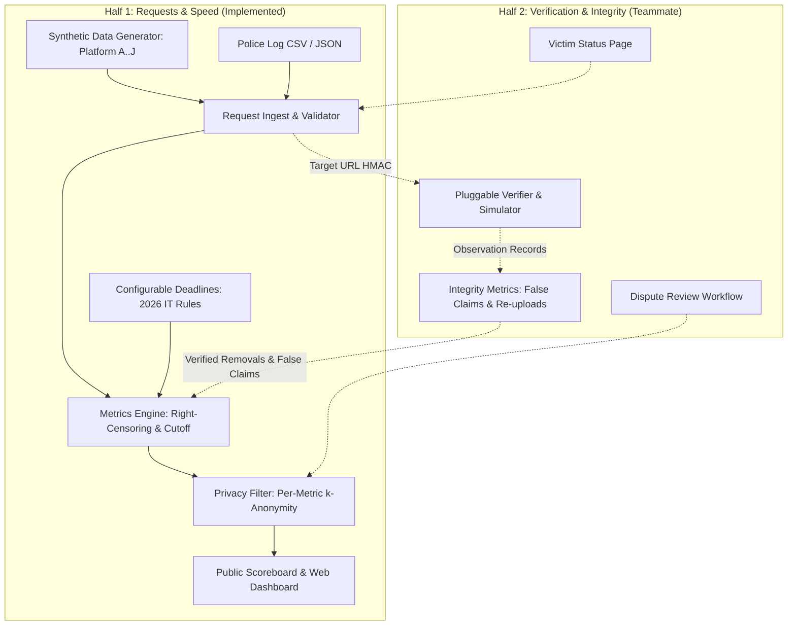

# Social Media Takedown Accountability Platform

[](https://github.com/iamnih4l/takedown-tracking/actions/workflows/ci.yml)
[](https://opensource.org/licenses/Apache-2.0)
[](https://www.python.org/)

An open-source accountability platform designed to audit and publish empirical response speed metrics for social media intermediaries responding to police takedown orders and data assistance requests under amended statutory rules.

---

## 1. Operating Modes & Deployment Notice

* **Demonstration Mode**: Uses 100% synthetic request records with **fictional platform identities** (`Platform A` through `Platform J`), HMAC-SHA-256 pseudonymized URL identifiers, and simulated response profiles. Built for public transparency demonstrations, method calibration, and automated regression testing without associating invented figures with real platforms.
* **Real-World Deployment**: Architected to operate inside an authorized, police-controlled boundary (e.g. prospective Kerala Police cyber infrastructure). All operational data remains strictly segregated within the agency environment, requiring an operator-configured `TAKEDOWN_HMAC_SECRET`.

> **Important Deployment Notice**:
> This open-source repository contains independent accountability tooling. It does not imply existing official integration, direct access to internal law enforcement databases, or formal governmental endorsement.

---

## 2. Architecture & Workstream Division



---

## 3. Shared Data Contracts

Both workstreams interface through shared, versioned JSON Schemas located in [`schemas/`](schemas/):

1. **[`request_log.schema.json`](schemas/request_log.schema.json)**:
   Standard contract for individual takedown and data request records. Defines mandatory identifiers, fictional and production platform enums, harm categories, legal routes (Rule 3(1)(d), Rule 3(2)(b)), ISO 8601 UTC timestamps, completeness flags, and HMAC URL hash structures (`content_url_hmac`).
2. **[`observation.schema.json`](schemas/observation.schema.json)**:
   Shared contract for independent external verification checks. Captures `verified_removed_at`, `reupload_detected_at`, `last_checked_at`, and observation statuses (`confirmed_removed`, `confirmed_available`, `uncertain`, `failed_check`).
3. **[`scoreboard.schema.json`](schemas/scoreboard.schema.json)**:
   Standard contract for public transparency reporting. Embeds metadata with `as_of` measurement cutoffs, overall aggregate statistics, right-censored percentile indicators, disaggregated breakdowns by platform and category, configured statutory deadlines, and per-platform integrity metrics.

---

## 4. Quickstart Guide

### 4.1. Requirements
* Python 3.10, 3.11, or 3.12 (Zero external runtime dependencies; uses Python standard library).
* `pytest` for test execution.

### 4.2. Local Installation
Clone the repository and set your `PYTHONPATH`:

```bash
# On Linux / macOS
export PYTHONPATH=src

# On Windows (PowerShell)
$env:PYTHONPATH="src"
```

### 4.3. Command-Line Interface (CLI)

```bash
# 1. Generate 300 reproducible synthetic records with fictional platforms and companion observations
python -m takedown_tracking.cli generate --count 300 --seed 42 --output data/demo_synthetic_requests.json --observations-output data/demo_observations.json

# 2. Validate and import request records
python -m takedown_tracking.cli import --input data/demo_synthetic_requests.json --quarantine data/quarantined_errors.json

# 3. Calculate raw performance metrics with measurement cutoff (as_of) and observations
python -m takedown_tracking.cli metrics --input data/demo_synthetic_requests.json --as-of "2026-10-01T00:00:00Z" --observations data/demo_observations.json

# 4. Export privacy-filtered public scoreboard (k=10 suppression)
python -m takedown_tracking.cli export-scoreboard --input data/demo_synthetic_requests.json --output data/demo_public_scoreboard.json --k-threshold 10 --as-of "2026-10-01T00:00:00Z" --observations data/demo_observations.json

# 5. Launch public dashboard and local API server
python -m takedown_tracking.cli serve --host 127.0.0.1 --port 8000 --data data/demo_synthetic_requests.json
```

Navigate to `http://127.0.0.1:8000/` in your browser to view the interactive dashboard.

---

## 5. Teammate Integration Checklist (Half 2)

This implementation provides shared hooks and models ready for **Half 2: Verification and Integrity**:

* [x] **Shared Request Model**: [`RequestRecord`](src/takedown_tracking/models/request.py) includes `content_url_hmac` for privacy-preserving record correlation (while PDQ perceptual image matching remains inside the verifier's isolated environment).
* [x] **Shared Observation Contract**: [`ObservationRecord`](src/takedown_tracking/models/observation.py) and [`observation.schema.json`](schemas/observation.schema.json) define the standard contract for independent checks.
* [x] **Verified Outcome Integration**: Metrics engine incorporates `verified_removed_at` when available, detects false removal claims when content remains available, and calculates per-platform integrity breakdowns.
* [x] **Right-Censored Survival Metrics**: Unresolved requests past deadline are right-censored, preventing survivorship bias without serializing non-standard `Infinity` or `NaN` values.
* [x] **Victim Privacy Guardrails**: Privacy filter applies $k$-anonymity independently per metric denominator, ensuring internal identifiers, exact hidden counts, and sensitive URLs are never exposed.

---

## 6. Automated Testing

Run the full automated test suite:

```bash
python -m pytest -v tests
```

Tests validate:
* Synthetic data generator determinism and fictional platform identities (`Platform A` .. `Platform J`).
* 2026 IT Rules statutory deadline resolution (Rule 3(1)(d)=3h, Rule 3(2)(b)=2h, urgent priority=3h) with strictest-minimum resolution.
* Right-censored percentile survival math (Platform A vs Platform B survivorship bias avoidance).
* Measurement cutoff (`as_of`) maturity rules and determinism.
* Independent per-metric $k$-anonymity threshold suppression and zero-PII leak guarantees.
* HMAC-SHA-256 URL hashing with fail-closed production safety.
* Shared verification observation integration and false removal claim detection.
* Web server static delivery and API endpoints.

---

## 7. Security & Credential Protection

* **Zero Committed Credentials**: Never hardcode GitHub tokens, API credentials, private keys, or passwords.
* **Authorized Authentication**: Use official credential helpers or environment-injected secrets; never print secrets in terminal sessions or temporary scripts.
* **Immediate Revocation**: Any accidentally exposed token must be revoked immediately via GitHub security settings.
* **Reporting**: Refer to [SECURITY.md](SECURITY.md) for vulnerability disclosure guidelines.

---

## 8. License

Licensed under the [Apache License, Version 2.0](LICENSE).
